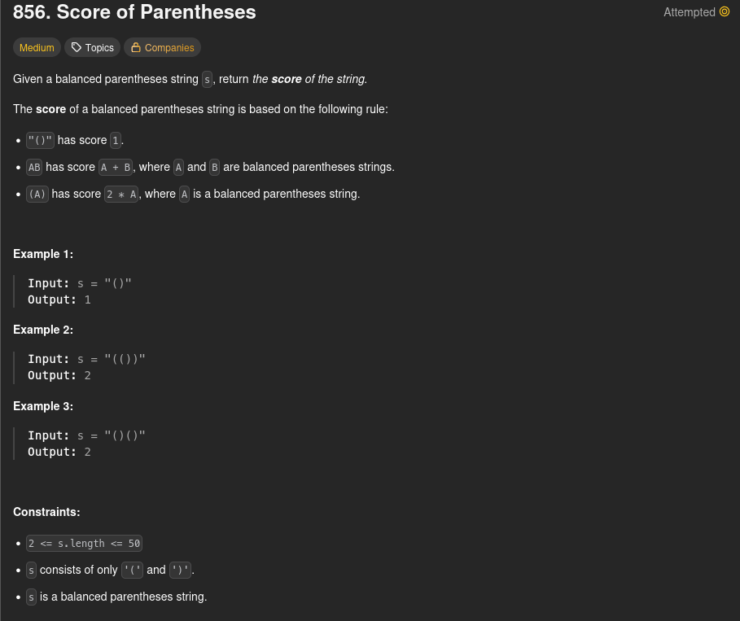

# 856. Score Of Parentheses



## Solutions

1. [Stack recording score at each nesting level](./s01_stack_recording_score_at_each_nest_level/Solution.md)
2. [Recurse, letting each recursive call evaluate one level](./s02_recurse_letting_each_recursive_call_evaluate_one_level/Solution.md)
3. [Count depth contributions of innermost pairs](./s03_count_depth_contributions_of_innermost_pairs/Solution.md)

## Commands

```python3 tests.py```

