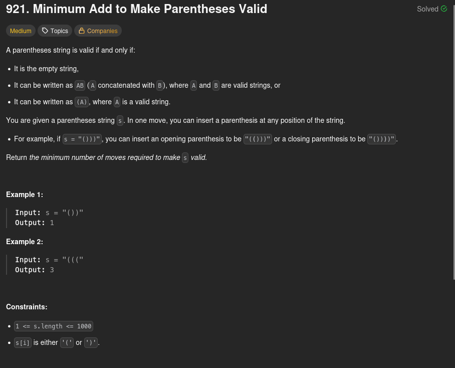

# 921. Minimum Add to Make Parentheses Valid



## Solutions

1. [Counting '(' and ')'](./s01_counting_open_and_close_parentheses/Solution.md)
2. [Track Lowest Prefix Balance](./s02_track_lowest_prefix_balance/Soluion.md)

## Commands

```python3 tests.py```

