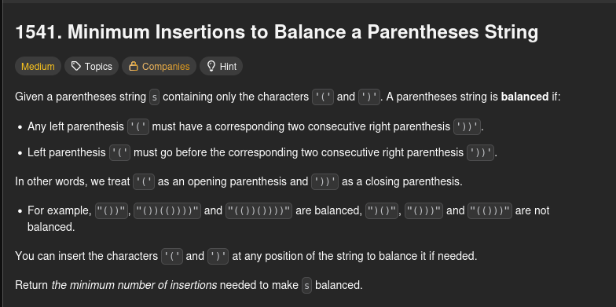
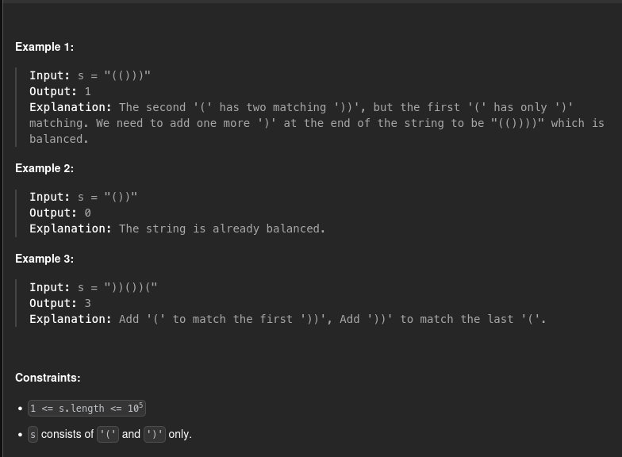

# 921. Minimum Add to Make Parentheses Valid




## Solutions

1. [Greedy with Counter](./s01_greedy_with_counter/Solution.md)
2. [Greedy that Explicitly Comsumes '))'](./s02_greedy_that_explicitly_consumes_closing_pairs/Solution.md)

## Commands

```python3 tests.py```
