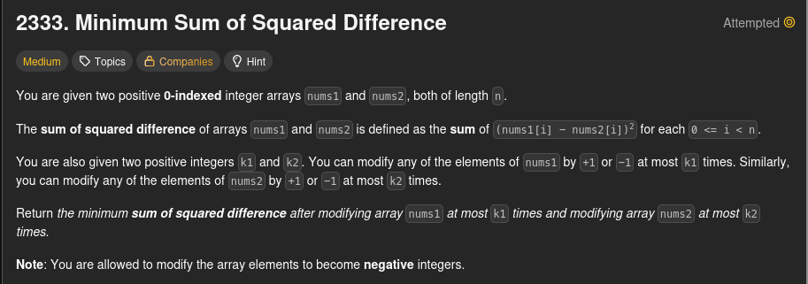
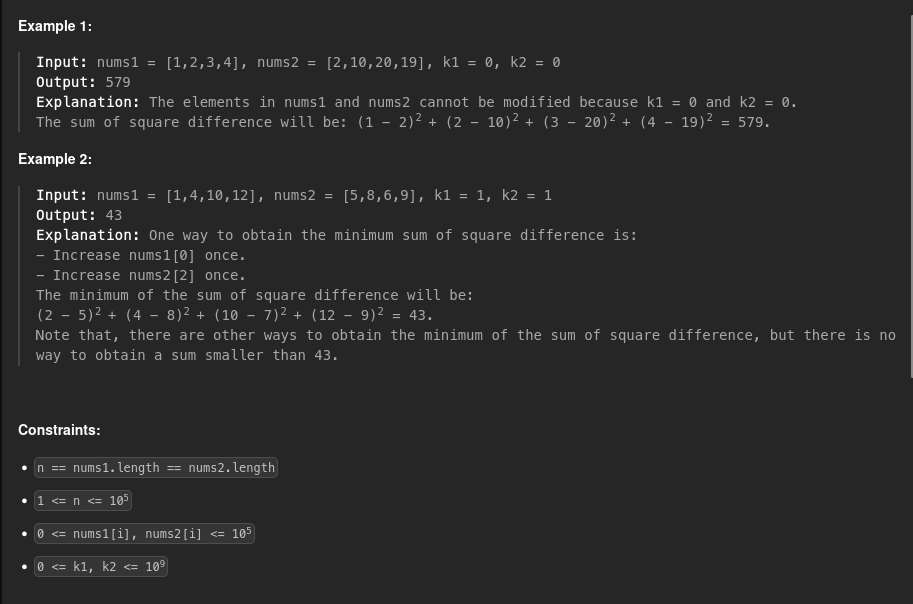

<h1>2333. Minimum Sum of Square Differences</h1>




<h2>Solutions</h2>

1. [Max Heap](./s01_max_heap/Solution.md)
2. [Frequency Buckets](./s02_frequency_buckets/Solution.md)
3. [Binary Search for a Final Height](./s03_binary_search_for_a_final_height/Solution.md)
4. [Sort and Lower Groups Together](./s04_sort_and_lower_groups_together/Solution.md)

<h2>Commands</h2>

```python3 tests.py```
